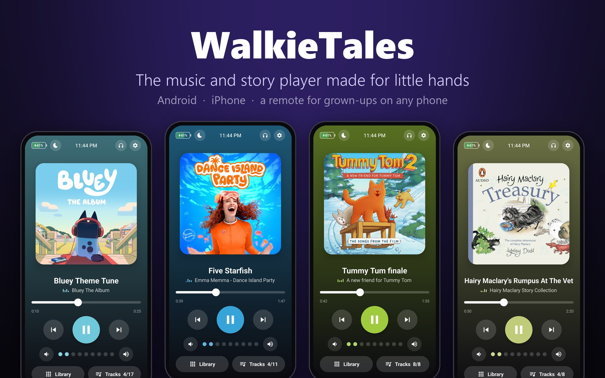
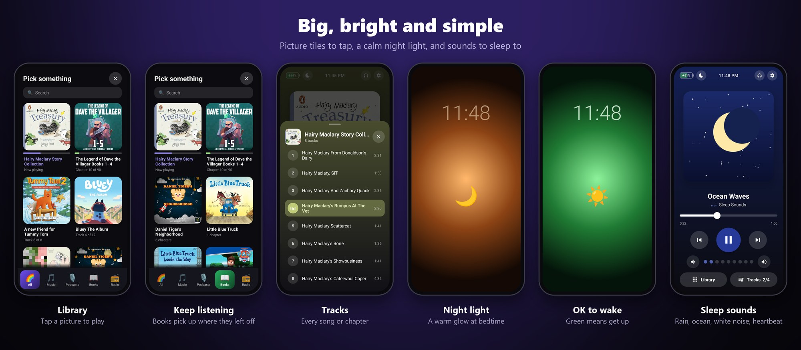
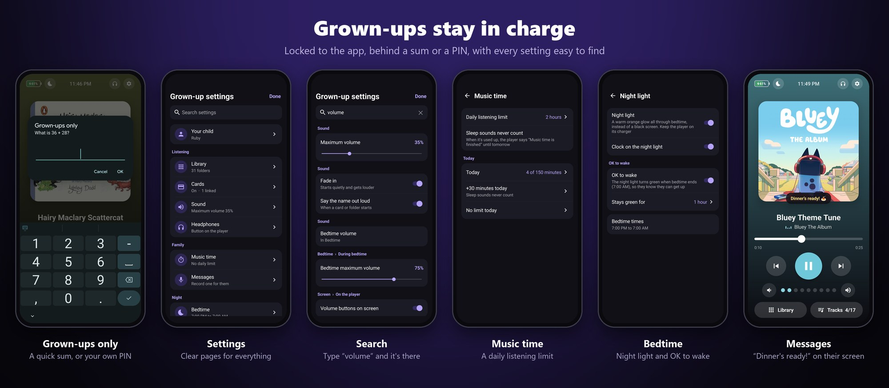
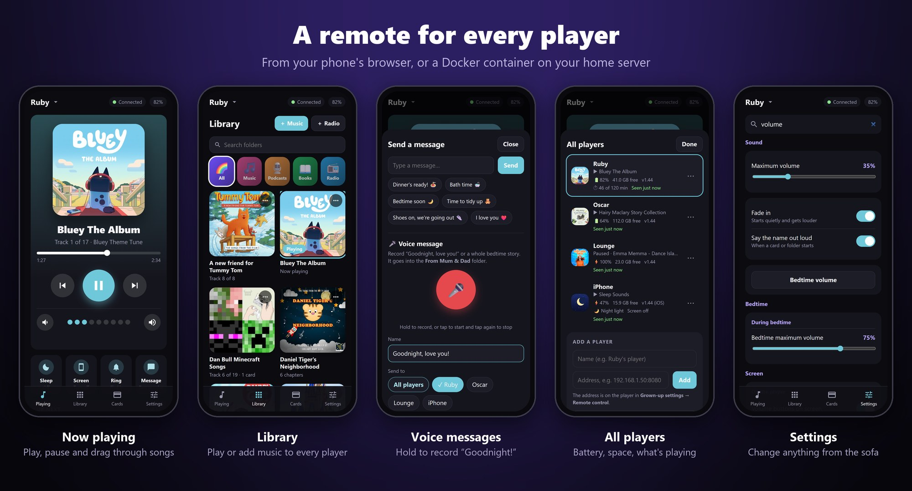

<p align="center"></p>

<p align="center">
  <b>Turn an old phone into a music and story player your kids can use on their own.</b><br>
  No ads, no accounts, no internet needed. Just their songs and stories, big and bright.
</p>

<p align="center">
  <a href="https://github.com/jaso1000/walkie-tales/releases/latest"><b>Download for Android</b></a> ·
  <a href="#iphone">iPhone</a> ·
  <a href="#the-remote">The remote</a> ·
  <a href="docs/SETUP.md">Full setup guide</a>
</p>

---

## Why WalkieTales

That old phone in the drawer can be your child's very own player. WalkieTales takes over the whole screen, so there's
no web browser, no app store and no way out. All that's left is the music and stories you put on it.

- **Tap a picture to play.** Every album, audiobook and podcast is a big picture tile. Little ones don't need to read.
- **Tap a card to play.** Stick NFC cards to pictures or toys, and tapping one on the phone plays its music (Android).
- **Books remember where they were.** Audiobooks and podcasts carry on from the right chapter, and recently played
  stories come first.
- **A night light that tells the time.** It glows warm orange through bedtime and turns **green when it's OK to get up**.
- **Sleep sounds built in.** Rain, ocean waves, white noise and a heartbeat, made on the phone and looping with no gaps.
- **Messages from you.** Send "Dinner's ready!" to their screen, or record "Goodnight, love you!" and it plays on their player.
- **Grown-ups stay in charge.** A maximum volume, a quieter bedtime, a daily listening limit, and settings locked
  behind a quick sum or your own PIN.

<p align="center"></p>

<p align="center"></p>

## Get started

### Android

1. Download **WalkieTales.apk** from the [latest release](https://github.com/jaso1000/walkie-tales/releases/latest).
2. Install it and copy music to the phone's `Music/Cards` folder, **one folder per album or book** (a `cover.jpg` is optional;
   WalkieTales finds covers itself).
3. To lock the phone to WalkieTales, connect it to a computer and run the few commands in the
   [setup guide](docs/SETUP.md#android). Works on Android 8 or newer, with or without Google.

After that, the [Docker remote](#one-remote-for-all-your-players-docker) can update every player over Wi-Fi.

### iPhone

The iPhone app runs on iOS 15 to 17.0 and installs with [TrollStore](https://github.com/opa334/TrollStore) (no jailbreak
or Apple developer account). It's locked in place with Guided Access. See the [iPhone guide](docs/SETUP.md#iphone).

### Using it

- **Tap a tile** to play. **Library** shows everything, with picture tabs for Music, Podcasts, Books and Radio.
- **Press and hold the cog** (top right), then answer the sum, for grown-up settings. The search box finds any setting.
- Settings are grouped by what you want to do: *Listening*, *Family* (music time, messages), *Night* (bedtime,
  night light, screen) and *Phone and safety*.

## The remote

<p align="center"></p>

Every player has a remote built in. In *Grown-up settings → Remote control* it shows an address and a PIN. Open the
address in any phone's browser on the same Wi-Fi, enter the PIN, and you can:

- play, pause, skip and drag through songs, change the volume and set a sleep timer
- browse the Library, **add music** from your phone, and add internet radio stations
- send a message to their screen, or **hold to record a voice message**
- change any setting, link cards, or turn their screen off from the next room

Tip: *Add to Home Screen* makes it open like an app.

### One remote for all your players (Docker)

Run the remote on a home server and you get one page for **every** player, plus:

- **All players at a glance:** battery, free space, version, what's playing and when each was last seen
- **Send to all:** upload an album or a radio station to every player in one go
- **Voice messages** recorded on your phone, converted for every player
- **iPhone-friendly music:** audio iPhones can't play is converted automatically
- **One-tap updates** for every Android player

```bash
curl -O https://raw.githubusercontent.com/jaso1000/walkie-tales/main/companion/docker-compose.yml
# set HTTPS_HOSTS to your server's address, then:
docker compose up -d
```

Open `http://<your server>:8090`, tap the name at the top and add your players (or let it find them on your Wi-Fi).
The image is `ghcr.io/jaso1000/walkie-tales-remote`, for normal servers and Raspberry Pi. Keep it up to date with
`docker compose pull && docker compose up -d`. More in the [remote's guide](companion/README.md).

## Good to know

- **Private by design.** No accounts and no tracking. The only things that go online are cover-art searches (only
  folder names are sent), internet radio if you add it, and the Docker remote checking GitHub for updates. The remote needs the player's PIN, and too many wrong PINs locks it out for a while. Keep ports 8080, 8090
  and 8490 off the internet.
- **Plays almost anything:** MP3, M4A/M4B audiobooks, AAC, FLAC, Ogg, Opus and WAV, plus internet radio.
- **Small and light.** The Android app is about 300 KB and runs on phones from 2013 onwards.

**Building it yourself, phone-by-phone notes and how it all works:** see [docs/SETUP.md](docs/SETUP.md).
